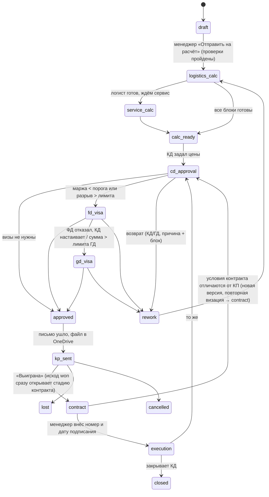
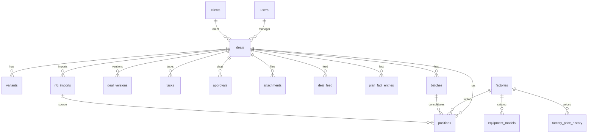

# Архитектура системы

Модуль расчёта себестоимости и маржинальности поставок ГШО. Соответствие разделам ТЗ указано в скобках.

## 1. Общая схема

```mermaid
flowchart LR
  subgraph Клиенты
    B[Браузер: десктоп / телефон<br/>React SPA]
  end
  subgraph Сервер в РФ (Docker)
    N[nginx] --> API[FastAPI<br/>app/api]
    API --> CORE[Ядро расчёта<br/>app/calc — чистый Python]
    API --> SVC[Сервисы<br/>RFQ-импорт, Excel, КП, workflow]
    API --> DB[(PostgreSQL)]
    API --> ADP[Адаптеры<br/>app/adapters]
    W[Воркер фоновых задач<br/>курс ЦБ, просрочки, входящая почта] --> DB
    W --> ADP
  end
  ADP --> SP[SharePoint / OneDrive<br/>Microsoft Graph]
  ADP --> OL[Outlook<br/>Microsoft Graph]
  ADP --> WC[WeCom 企业微信]
  ADP --> CBR[cbr.ru XML]
  ADP -.-> YD[Яндекс Диск / S3 / Яндекс 360]
  B --> N
  B -- OIDC --> ID[Entra ID / Яндекс ID / Keycloak]
```

Принципы:

* **Ядро расчёта отделено от БД и веба** (`app/calc`). На вход — `DealCalcInput` (pydantic), на выход — `DealCalcResult`. Это даёт воспроизводимость (версия расчёта хранит вход и выход целиком), простую приёмку «сходится с ручным Excel до рубля» и тесты без инфраструктуры.
* **Серверная фильтрация полей по ролям** (`app/core/roles.py`): закрытые для роли ключи вырезаются из JSON перед отправкой; интерфейс не получает себестоимость и маржу, а не прячет их (раздел 2).
* **Сменные адаптеры** (`app/adapters`): хранилище, почта, мессенджер, источник курсов и провайдер входа выбираются настройками без правки прикладного кода (раздел 13).
* **Версии неизменяемы**: `deal_versions` фиксирует вход, результат, курс ЦБ, Excel-файлы; триггеры БД запрещают изменение; `audit_log` — только вставка (раздел 3, 14).
* **Правила визации — данные**: ступени и условия хранятся в настройке `approval_ladder`; администратор добавляет ступень без доработки кода (раздел 10).

## 2. Слои и модули

| Слой | Модули | Назначение |
| --- | --- | --- |
| Ядро расчёта | `calc/types.py`, `calc/costing.py`, `calc/fx_forecast.py`, `calc/cashflow.py`, `calc/service.py` | 14 статей × 3 сценария, прогноз курса (A, Б×В, Г), волатильность, денежный поток и кассовый разрыв, стоимость денег, сервис до наработки, чувствительность, подбор цены по марже/наценке |
| Бизнес-правила | `core/workflow.py`, `core/roles.py` | Статусы и переходы, задачи и SLA, ступени визации, проверки менеджера, матрица прав и фильтрация полей |
| Сервисы | `services/rfq_import.py`, `rfq_template.py`, `excel_export.py`, `kp_generator.py`, `history_check.py`, `settings_service.py`, `deal_calc.py`, `deal_service.py` | Разбор RFQ по кодам полей, Excel-расчёт с живыми формулами (10 листов, версия менеджера), КП по бренд-буку с проверкой утечек, сверка с историей, настройки с историей, сборка входа расчёта из карточки, версии/задачи/уведомления |
| API | `api/auth.py`, `deals.py`, `logistics.py`, `service.py`, `pricing.py`, `references.py`, `admin.py`, `tasks_files_planfact.py` | REST по блокам ролей (см. docs/API.md) |
| Адаптеры | `adapters/storage.py`, `mail.py`, `messenger.py`, `fx_source.py`, `core/auth.py` | SharePoint/Yandex Disk/S3/local; Outlook/Яндекс SMTP/console; WeCom/console; ЦБ РФ; Entra/Yandex/Keycloak/dev |
| Фронтенд | `frontend/src` | Список и доска сделок, карточка по блокам, экран КД с живым пересчётом и графиком потока, блоки логиста и сервиса, задачи, клиенты, настройки |

## 3. Модель себестоимости (раздел 7)

Для каждой позиции в каждом сценарии:

1. **Цена завода** — по графику платежей заводу; каждый платёж переводится в RUB по прогнозному курсу на свою дату (`fx_forecast.forecast_rate`), «зафиксированный» курс заменяет прогноз.
2–3. Внутрикитайская логистика и экспортные формальности — валюта ввода, курс на дату отгрузки.
4–5. Международная перевозка и страхование — статьи партии, распределённые на позиции по стоимости / весу / объёму.
6–7. Пошлина и НДС — от **таможенной стоимости** = статьи 1–5 в валюте × курс на дату выпуска декларации. Ввозной НДС по умолчанию принимается к зачёту: его сумма идёт в денежный поток (отток при декларации, возврат через `vat_offset_days`), а в себестоимость попадает только стоимость денег до зачёта (через статью 11). Флаг `import_vat_in_cost` переключает на учёт НДС как расхода.
8–10. Брокер/СВХ/утильсбор, сертификация, доставка по РФ — RUB.
11. **Финансовые расходы** = стоимость денег на отрицательном остатке (точная интеграция по дням) + комиссии за конвертацию и переводы + банковские гарантии − доход от размещения (опция ФД).
12. Сервис до наработки — валютная часть (ЗИП, резерв) по курсу на дату поставки + рублёвая часть (работы, выезды, ПНР, обучение).
13. Гарантийный резерв — % от статьи 1 по типу машины.
14. Накладные — % от суммы 1–13 по шкале от размера сделки (5/4/3 %); переопределение КД → виза ГД.

Маржа `M% = (P − C)/P`, наценка `N% = (P − C)/C` — справочно. Порог сравнивается с маржой базового сценария; предупреждение, если маржа пессимистичного < 0. Цена задаётся суммой, наценкой или целевой маржой (`solve_price` — итерация, так как стоимость денег зависит от графика притоков).

Чувствительность: Δ маржи при курсе +1 % и курс безубыточности по порогу (линейная экстраполяция по двум точкам).

## 4. Прогнозный курс (раздел 8)

`K(T) = w_A·K_ЦБ(1 + r_A·T/365) + w_B·K_ЦБ(1 + r_B·T/365)·s_m + w_G·K_ФД(T)`

* A — форвард по разнице ставок (ключевая ЦБ − ставка иностранного ЦБ).
* Б — среднегодовой тренд по истории ЦБ за N лет; В — сезонный коэффициент месяца платежа (среднее отношение курса месяца к среднему за год, с разбросом min/max по годам). Сезонность включается плавно на первых 30 днях горизонта, чтобы при T=0 прогноз равнялся K_ЦБ.
* Г — экспертные точки ФД (интерполяция); если не заданы, вес уходит на A и Б×В.
* ΔK — стандартное отклонение T-дневного изменения курса за N лет × 1,0 (пессим.) / 0,6 (оптим.), либо фиксированные ΔK из настроек.

Все компоненты по каждому платежу фиксируются в версии и выводятся на листе «Курсы» и на экране КД.

## 5. Бизнес-процесс (раздел 3)



Каждый переход создаёт задачу с нормативным сроком (рабочие дни по производственному календарю РФ, `calc/calendar.py`, настройка `sla_days`) и уведомления (Outlook + WeCom + в системе по каналам пользователя). Возврат и утверждение создают новую версию; изменение цены или условий оплаты после визы сбрасывает визы и возвращает на ступень 1.

### 5.1 Изменения ноября 2026 (документ «Задачи на изменение», задачи 1–11)

| № | Что изменилось | Где |
| --- | --- | --- |
| 1 | Условия оплаты клиента и график оплаты заводу задаёт **КД** (ГД — те же права); менеджер вводит только «пожелания клиента по оплате». Пока условия не заданы — типовые схемы из настроек (`default_client_payment_scheme`: 30 % после подписания, 70 % аккредитивом через 5 раб. дней после CMR; `default_factory_payment_scheme`: 30 % через 14 раб. дней после контракта с заводом, 70 % через 14 раб. дней после готовности). События платежей расширены (`PaymentEvent`: client_prepayment, lc_opened, factory_contract, factory_prepayment, border); смещения в календарных или рабочих днях. БГ на аванс (`advance_guarantee_cost`: разовый %, % годовых до поставки клиенту, фиксированная сумма) — в статье 11; комиссии за аккредитив не учитываются. Логист вводит плановую и фактическую дату CMR в партии. | `calc/types.py`, `calc/costing.py`, `calc/calendar.py`, `api/pricing.py` (`/payment-terms`), `core/workflow.cd_checks` |
| 2 | После выигрыша — стадии **contract → execution → closed**. 15 этапов исполнения (`execution_stages`) строятся из плановых дат расчёта по позициям/партиям; фактические даты вводят ответственные по ролям, платежи и аккредитив — ФД (попадают в план/факт); ввод факта пересчитывает последующие даты и платежи. Изменение условий контракта → новая версия и повторная визация с КД. Закрывает КД. | `services/execution_service.py`, `api/execution.py` |
| 3 | Срок производства: значение + единица (календарные/рабочие дни, недели, дата) + точка отсчёта (контракт с заводом / предоплата заводу). Срок поставки клиенту по каждой позиции/партии: от точки отсчёта (подписание / аванс клиента / аккредитив) до поставки, × (1 + `delivery_reserve_pct`), округление вверх до целой недели; резерв — только в КП и контракте. | `calc/terms.py`, `PositionCost.delivery_term`, `kp_generator.py` |
| 4 | Таблица теххарактеристик позиции (`position_tech_params`: № / параметр / ед. / требования заказчика / значение / комментарий), шаблоны по типу машины (обязательность задают КД/ГД; стартовый — RFQ 1–11), глоссарий RU↔ZH (`glossary`; машинный перевод — только после подтверждения), адаптер переводчика (Яндекс Переводчик), двуязычный запрос заводу (WeCom + e-mail), импорт файла клиента и ответа завода с предпросмотром, выбором столбцов/строк и сопоставлением по № и названию. | `services/tech_params_service.py`, `adapters/translator.py`, `api/tech_params.py`, `api/catalog.py` |
| 5 | Варианты не обязательны: без отметки «Альтернативные предложения» система ведёт один служебный вариант (`is_default`) со всеми позициями; с отметкой — минимум два предложения, каждое со своей ценой и условиями. При выигрыше указывается выбранное предложение. | `api/deals.ensure_default_variant`, `core/workflow.manager_checks` |
| 6 | Опции, реализуемые в России (`local_options`): не идут в запрос заводу; статья 15 «Доукомплектование в РФ» (закупка + монтаж); задачи на этапе расчёта (КП поставщиков — менеджер, установка — сервис, утверждение — КД/закупки) и на стадии контракта («заказать» = дата потребности − срок поставщика − `local_options_order_reserve_days`, «установить»); установка до передачи клиенту удлиняет срок поставки, во время ПНР — нет. Роль «Закупки» заложена. | `calc/costing.py`, `api/images_options.py`, `execution_service` |
| 7 | Каталог: производитель → тип машины (`machine_types`) → модель → **исполнение** (`equipment_executions`, набор теххарактеристик, опции РФ, изображения). Пополнение после КП с двойным подтверждением (менеджер → КД/ГД). История цен и сроков завода (менеджер, КД, ГД) и история цен клиентам `client_price_history` (КД, ГД). Собственное наименование под брендом компании (`brand_name`). | `services/catalog_service.py`, `api/catalog.py` |
| 8 | Карточка клиента: история всех КП со всеми версиями (КД, ГД). | `api/references.client_card` |
| 9 | Один запрос нескольким заводам → ответы-кандидаты (`factory_offers`) → сравнение «параметр × завод» → отбор КД/ГД: первый ответ в заявку, остальные — отдельные заявки через **«Дублировать заявку»** (копия требований, теххарактеристик, изображений, опций и расчётов логиста/сервиса с задачами на проверку; `parent_deal_id`, `request_group_id`, номер `D-2026-0042-2`). При выигрыше одной заявки связанные закрываются автоматически. Бренд подачи КП (`kp_brand`: марка завода / бренд компании с проверкой утечки названия завода и китайского текста). | `services/offers_service.py`, `api/tech_params.py` (offers), `api/deals.duplicate` |
| 10 | Изображения и чертежи позиции (`position_images`; загружают менеджер, КД, ГД); «В КП» и способ вложения (в документ / к письму / оба) выбирает КД/ГД, по умолчанию ничего не вкладывается; файлы клиента можно приложить к запросу заводу, у завода запрашиваются фото и чертежи. | `api/images_options.py`, `kp_generator._add_image` |
| 11 | Уровни доступа как данные: матрица «роль × группа полей → 0/1/2» (`access_rules`) и исключения для сотрудников (`access_user_overrides`, срок, основание); меняют администратор и ГД; ГД наследует права КД; серверная фильтрация читает правила из БД. Стартовая матрица — `core/roles.DEFAULT_MATRIX`. | `core/roles.py`, `services/access_service.py`, `api/admin.py` (`/access`) |

Схема обновляется без alembic: `python -m scripts.migrate` (create_all + ALTER TABLE ADD COLUMN + ALTER TYPE ADD VALUE), это же делает `scripts.seed` при деплое.

## 6. Схема БД



| Таблица | Назначение | Ключевые поля |
| --- | --- | --- |
| `users` | Учётные записи из Entra ID / Яндекс ID, роли (несколько), объём наблюдателя, каналы уведомлений | `external_id`, `email`, `roles[]`, `notify_channels[]`, `wecom_user_id` |
| `clients` | База клиентов, дубли по ИНН запрещены | `inn` (unique), `sites[]`, `contacts[]`, `manager_id` |
| `factories` | Заводы-поставщики (0.7–0.8), WeCom-контакты | `name` (unique), `wecom_external_ids[]`, `typical_production_days` |
| `equipment_models` | Каталог оборудования: техпараметры RFQ 1–11 по кодам, поля L, ТН ВЭД по умолчанию, регламенты ТО | `(factory_id, model)` unique, `tech_params`, `logistics_params`, `maintenance_regulations` |
| `factory_price_history` | История цен заводов из каждого импорта RFQ и факта | `factory_id`, `model`, `unit_price`, `currency`, `on`, `deal_id`, `source` |
| `logistics_history` | История статей логиста (план и факт) по маршруту/типу/региону | `item_code`, `route`, `machine_type`, `amount`, `per_unit`, `on` |
| `hs_codes` | ТН ВЭД с версиями ставок и датами действия | `code`, `duty_pct`, `vat_pct`, `util_fee`, `certification[]`, `valid_from/to` |
| `rate_settings` | «Ставки и нормативы» с историей (действующая запись — `valid_to IS NULL`) | `key`, `value` (JSON), `valid_from/to`, `changed_by`, `comment` |
| `payment_schemes` | Типовые схемы оплаты | `name`, `lines[]` |
| `templates` | RFQ, КП (DOCX), Excel, письма, WeCom, логотипы — с версиями | `kind`, `version`, `file_path`, `is_active` |
| `fx_rates` | Курсы ЦБ с 2014 г. и ручные курсы | `(on, currency, source)` unique, `rate`, `comment` |
| `deals` | Карточка сделки | `number`, `status`, `manager_id`, `service_flag`, `target_hours`, `client_payments[]`, `scenario_override`, `current_version_no`, `approved_version_id`, `storage_folder`, `outcome` |
| `positions` | Позиции оборудования с данными RFQ, блоками логиста и сервиса | `factory_id`, `model`, `qty`, `unit_price`, `currency`, `factory_payments[]`, `tech_params`, `logistics_params`, `price_reference`, `logistics` (JSON), `batch_id`, `service_calc` (JSON) |
| `batches` | Партии и консолидация | `route`, `transport_units`, `transit_days`, `customs_days`, `allocation`, `items` (JSON со сверками) |
| `variants` | Варианты комплектации/условий, цена КД | `position_ids[]`, `price_rub`, `price_mode`, `service_in_kp`, `client_payments[]`, `overhead_pct_override` |
| `deal_versions` | Неизменяемые версии расчёта | `version_no`, `reason`, `calc_input` (JSON), `calc_result` (JSON), `excel_path`, `excel_manager_path`, `kp_path` |
| `rfq_imports` | Попытки импорта RFQ с версиями файла и ошибками | `file_hash`, `template_version`, `attempt`, `parsed`, `errors[]` |
| `tasks` | Задачи по переходам с SLA | `role`, `assignee_id`, `block`, `due`, `done_at`, `overdue_notified` |
| `approvals` | Визы: версия, пользователь, дата, комментарий, снимок цен; сброс | `step`, `role`, `approved`, `prices_snapshot`, `reset_at` |
| `audit_log` | Журнал «кто, когда, что было / стало», только вставка | `entity`, `entity_id`, `action`, `before`, `after` |
| `attachments` | Файлы в хранилище со ссылкой и хешем | `folder` (01…07), `storage_path`, `storage_url`, `sha256` |
| `deal_feed` | Лента: WeCom, письма, системные события | `kind`, `direction`, `counterparty`, `external_id` |
| `plan_fact_entries` | Факт по статьям и платежам | `kind`, `cost_item_code`, `amount`, `currency`, `fx_rate`, `on`, `deviation_reason` |
| `notifications` | Очередь и журнал уведомлений по каналам | `event`, `channel`, `status`, `error` |
| `integration_log` | Журнал обменов с Graph, WeCom, ЦБ | `system`, `operation`, `ok`, `details` |

Коды статей себестоимости (`factory_price` … `overhead`) едины в ядре, Excel, план/факте и будущем API для 1С (раздел 15).

## 7. Безопасность (раздел 2, 14)

* Вход только через OIDC корпоративного провайдера; сессия — подписанная HttpOnly-cookie с истечением через 8 ч бездействия (скользящее обновление). Отключение учётной записи — `is_active=false` (синхронизация с Entra ID по группам / вручную).
* Права на данные — на сервере: видимость сделок (`can_see_deal`) и фильтрация полей (`filter_payload`); файлы папки «04 Расчёт себестоимости» и полный Excel отдаются только КД/ФД/ГД.
* Секреты интеграций — только в переменных окружения / защищённом хранилище; HTTPS на nginx; журнал действий неизменяем (триггеры в `migrations/001_audit_immutable.sql`).
* Курсы и справочники хранятся с датами действия; версия расчёта фиксирует курс и настройки на дату.

## 8. Производительность и эксплуатация (раздел 14)

* Пересчёт сделки: чистый Python, 50 позиций × 3 сценария — доли секунды (кэш прогнозов по датам платежей).
* Excel и КП формируются при утверждении; в проде — в воркере очереди (arq/Celery) с ограничением 30 с.
* Docker Compose: PostgreSQL, backend, frontend (nginx), контейнер ежедневных копий (БД + файлы, 90 дней).
* Локализация: все тексты интерфейса — в ресурсных строках компонентов (вынести в `i18n` во второй очереди), справочники с полями RU/EN/ZH (`equipment_models.names`, `factories.name_zh`).

## 9. Решения и допущения, требующие подтверждения

1. **Ввозной НДС** учтён как возмещаемый (в себестоимости — стоимость денег до зачёта). Если компания на УСН или НДС не возмещается — `import_vat_in_cost=true`.
2. **Сезонность** включается плавно на горизонте 0–30 дней (иначе прогноз на «сегодня» отличался бы от курса ЦБ).
3. **Срок поставки** в сценарии: Δt применяется к сроку производства; транзит и оформление берутся из партии.
4. **Накладные** считаются от прямой себестоимости варианта (вариант = альтернатива сделки в КП).
5. **Даты платежей заводу** отсчитываются от плановой даты договора (`kp_due` или дата расчёта + 14 дней) — уточнить, от чего считать аванс до подписания договора.
6. Назначение задач: исполнитель блока — закреплённый за сделкой или первый активный пользователь роли; правило назначения вынести в настройки.
